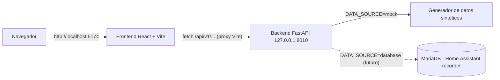

# Arquitectura

## Visión general



1. El **frontend** (SPA React compilada con Vite) consume la API mediante `fetch` y gestiona caché,
   reintentos y refresco con **TanStack Query**.
2. En desarrollo, el **proxy de Vite** redirige `/api/*` al backend en `127.0.0.1:8010`.
3. El **backend FastAPI** calcula las agregaciones. Con `DATA_SOURCE=mock` genera datos
   sintéticos; cuando se habilite `DATA_SOURCE=database`, leerá de la base de datos real de Home
   Assistant (solo lectura).
4. Cada respuesta es JSON bajo `/api/v1` y está descrita con **Pydantic** (contrato de la API).

El origen de los datos sintéticos y el plan de migración están en [`datos.md`](datos.md). El catálogo
de estadísticos, en [`estadisticos.md`](estadisticos.md).

## Módulos funcionales (pestañas)

El panel se organiza en **seis pestañas**. Cada una agrupa varias gráficas de un dominio:

| Pestaña | Qué muestra | Endpoints | Componentes |
| ------- | ----------- | --------- | ----------- |
| Resumen | KPIs de cabecera | (reutiliza los demás) | `OverviewSection` |
| Electricidad | Consumo, desglose, comparativa, eficiencia y por edificio | `/energy/consumption`, `/energy/breakdown`, `/energy/compare`, `/energy/efficiency`, `/energy/by-building` | `EnergyConsumptionChart`, `EnergyBreakdownChart`, `EnergyCompareChart`, `EnergyEfficiencyChart`, `EnergyByBuildingChart` |
| Iluminación | Luminarias frente a luz natural y despilfarro | `/lighting/consumption`, `/lighting/by-space`, `/lighting/waste` | `LightingConsumptionChart`, `LightingBySpaceChart`, `LightingWasteChart` |
| Climatización y gas | Gas/grados-día, electroválvulas y aulas vacías | `/climate/gas`, `/climate/valves`, `/climate/empty-spaces` | `GasConsumptionChart`, `ValvesTemperatureChart`, `EmptySpacesHeatingChart` |
| Ocupación y aire | Cruce ocupación ↔ CO₂ | `/correlation/occupancy-air-quality` | `OccupancyAirQualityChart` |
| Decisiones | Ranking de oportunidades de ahorro | `/decisions/opportunities` | `DecisionsPanel` |

## Estructura del repositorio

```text
smartesi-stats/
├── backend/                    API FastAPI (Python)
│   ├── app/
│   │   ├── main.py             App, CORS, TrustedHost, health checks y handlers de error
│   │   ├── api/                Routers: energy, lighting, climate, decisions, correlation, meta
│   │   ├── core/
│   │   │   ├── config.py       Ajustes (.env) — DATA_SOURCE y factores de conversión
│   │   │   ├── clock.py        Utilidades de tiempo (UTC vs. hora local Europe/Madrid)
│   │   │   ├── cache.py        Caché TTL en memoria para las series agregadas
│   │   │   └── energy_map.py   Catálogo de edificios y espacios (+ área y luminarias)
│   │   ├── db/session.py       Sesión SQLAlchemy async (solo DATA_SOURCE=database)
│   │   ├── schemas/            Modelos Pydantic de respuesta
│   │   └── services/
│   │       ├── mock_data.py        Generador determinista de datos sintéticos
│   │       ├── stats.py            Estadística descriptiva y regresión
│   │       ├── energy_service.py   Consumo, desglose, comparativa y eficiencia
│   │       ├── lighting_service.py Iluminación (luminarias y despilfarro)
│   │       ├── climate_service.py  Gas, grados-día, válvulas y aulas vacías
│   │       ├── decisions_service.py Ranking de oportunidades de ahorro
│   │       └── correlation_service.py  Cruce ocupación–aire
│   └── tests/                  Tests unittest (API con TestClient)
├── frontend/                   SPA React + Vite
│   └── src/
│       ├── app/
│       │   ├── api/            fetch tipado + baseUrl (VITE_API_BASE_URL opcional)
│       │   ├── context/        RangeContext: periodo global de todas las gráficas
│       │   ├── hooks/          useBuildings, useEnergy*, useLighting, useClimate,
│       │   │                   useDecisions, useOccupancyAirQuality
│       │   ├── components/     Header, ui/ y stats/ (con subcarpetas por dominio)
│       │   ├── pages/          Stats.tsx (pestañas), NotFound.tsx
│       │   ├── lib/            format, chartTheme, sections
│       │   └── types/          DTOs de la API en snake_case
│       ├── assets/             Logos y banner (reutilizados del proyecto original)
│       └── styles/             theme.css, tailwind.css, index.css
├── docs/                       Esta documentación
└── README.md
```

## Contrato de la API

Prefijo común: `/api/v1`.

| Método | Ruta | Parámetros | Devuelve |
| ------ | ---- | ---------- | -------- |
| GET | `/meta/buildings` | — | Edificios (id, label, aforo, área, luminarias, consigna) y espacios (id, label, edificio, tipo, área, luminarias, válvula). |
| GET | `/energy/consumption` | `range`, `building=all\|<id>`, `metric=kwh\|cost\|co2` | `series` (timestamp, value), `total`, `average`, `peak`, `unit`, `granularity`. |
| GET | `/energy/by-building` | `range`, `metric` | Totales y `share` por edificio + por espacio. |
| GET | `/energy/breakdown` | `range`, `building` | `series` (base, activity, lighting, other), totales y cuotas de carga base e iluminación. |
| GET | `/energy/compare` | `range`, `building`, `metric` | `series` (current, previous), `current_total`, `previous_total`, `delta_pct`. |
| GET | `/energy/efficiency` | `range` | kWh/m² y kWh/persona·hora por edificio y por espacio. |
| GET | `/lighting/consumption` | `range`, `building` | `series` (lighting, other, total, occupancy_pct, daylight_hours) y KPIs de luminarias. |
| GET | `/lighting/by-space` | `range`, `building` | Ranking de espacios por consumo de luminarias y sus cuotas. |
| GET | `/lighting/waste` | `range`, `building` | Luz sin ocupación, cuota, coste y `€/año` por espacio. |
| GET | `/climate/gas` | `range`, `building` | `series` (gas, degree_days, temperaturas, % válvulas) y `stats` (correlación, kWh/grado-día…). |
| GET | `/climate/valves` | `range`, `building` | `series` (% válvulas, temperatura, consigna) y estado por aula. |
| GET | `/climate/empty-spaces` | `range`, `building` | Gas sin ocupación y horas calentadas por espacio + €/año. |
| GET | `/decisions/opportunities` | `range`, `building` | Oportunidades priorizadas con `savings_eur_year` y total. |
| GET | `/correlation/occupancy-air-quality` | `range`, `building` | `points` y `stats` (Pearson, medias y reparto good/moderate/poor). |
| GET | `/health/live` | — | Estado y `data_source` actual. |
| GET | `/health/ready` | — | Estado de las dependencias. |

Rangos admitidos y su granularidad:

| `range` | Periodo | Series temporales | Dispersión (correlación) |
| ------- | ------- | ----------------- | ------------------------ |
| `day` | últimas 24 h | 24 puntos (hora) | 24 puntos |
| `week` | últimos 7 días | 7 puntos (día) | cada 3 h |
| `month` | últimos 30 días | 30 puntos (día) | cada 12 h |
| `year` | últimos 12 meses | 12 puntos (mes) | cada 24 h |

## Decisiones de diseño

- **Datos deterministas**: el generador siembra su aleatoriedad con un hash de (edificio/espacio +
  hora), de modo que una misma consulta devuelve siempre el mismo valor (estable y testeable).
- **Periodo global en el frontend**: el rango vive en un contexto (`RangeContext`) y lo comparten la
  cabecera y todas las gráficas; edificio y métrica se eligen por gráfica.
- **Caché TTL en backend** (`STATS_CACHE_TTL_SECONDS`, 30 s por defecto) sobre las series agregadas.
- **`placeholderData` en el frontend**: al cambiar de rango se siguen mostrando los datos
  anteriores mientras llegan los nuevos (sin parpadeo).
- **Errores saneados**: el backend nunca devuelve trazas; los errores no controlados se convierten
  en `500 {"detail": "Internal server error"}`.
- **Sin acoplar al despliegue**: las URLs de la API son relativas por defecto; el proxy de Vite se
  encarga en desarrollo. Opcionalmente se puede apuntar a otro host con `VITE_API_BASE_URL`.
